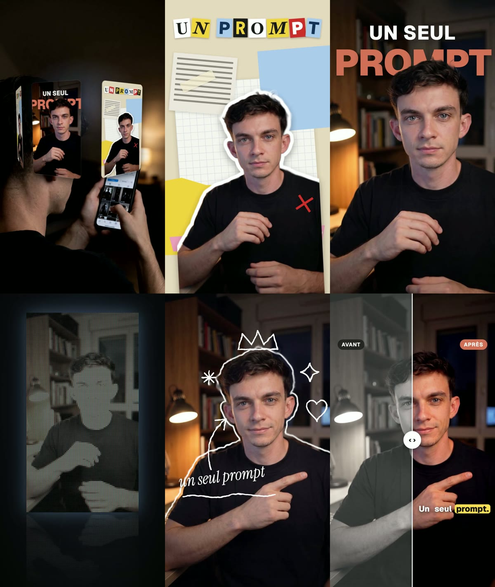

# 6 effets vidéo pour tes reels, en une commande chacun



Tu donnes ta vidéo à Claude Code, tu tapes la commande de l'effet, et il te rend un clip vertical **1080 × 1920** prêt à monter dans ton reel. Pas d'After Effects, pas de CapCut : l'effet est codé en HTML et rendu image par image sur ta machine, avec flou de mouvement.

| Commande | L'effet | Exemple |
|---|---|---|
| `/carrousel-3d` | Tes images (captures, couvertures, produits) sur un grand anneau 3D qui tourne au-dessus de ta vidéo | `/carrousel-3d` avec 5 captures |
| `/papier-decoupe` | Toi en autocollant sur un collage de papiers, titre en lettres découpées, animé en stop-motion | `/papier-decoupe "UN PROMPT"` |
| `/texte-derriere` | Un mot géant qui surgit et passe derrière ta tête | `/texte-derriere "UN SEUL" "PROMPT"` |
| `/ecran-led` | Des mots en points LED, puis ta vidéo sur un panneau géant | `/ecran-led "Tout fait en un prompt"` |
| `/doodle` | Un contour blanc qui tremble autour de toi, une couronne et des dessins à main levée | `/doodle "un seul prompt"` |
| `/avant-apres` | Un curseur qui glisse entre ton avant et ton après, sous-titres animés | `/avant-apres brut.mp4 final.mp4` |

Les commandes s'écrivent en langage normal, par exemple : `/texte-derriere sur ma-video.mp4 avec le mot CODE en bleu`. Claude choisit les options, fait un aperçu rapide, vérifie le résultat image par image, puis lance le rendu final.

## Installer (2 minutes)

1. Copie les 7 dossiers de `effets/skills/` dans `~/.claude/skills/` (Mac / Linux) ou `%USERPROFILE%\.claude\skills\` (Windows). En une ligne sur Mac / Linux :

```bash
git clone --depth 1 https://github.com/achillebrl/skills-ia /tmp/skills-ia && cp -R /tmp/skills-ia/effets/skills/* ~/.claude/skills/
```

2. Installe [uv](https://docs.astral.sh/uv/) si tu ne l'as pas (`curl -LsSf https://astral.sh/uv/install.sh | sh`), puis relance Claude Code.
3. Tape `/effets` : Claude vérifie l'installation et télécharge une fois Chromium et le modèle de détourage (≈ 180 Mo).

Le dossier `effets` est le moteur commun ; les 6 autres sont les commandes. Garde-les tous les 7 côte à côte.

## Ce qu'il faut filmer

- **Face caméra, de la taille à la tête** (papier découpé, texte derrière, écran LED) : téléphone fixe à hauteur des yeux, pièce plutôt sombre, une lampe de côté, de l'espace au-dessus de la tête. Pas besoin de parler.
- **Plan serré, tête et buste** (doodle, avant/après) : bras croisés ou mains jointes, silhouette nette.
- **Par-dessus ton épaule, téléphone en main** (carrousel 3D) : le haut de l'image vide, l'anneau tourne au-dessus.

3 à 5 secondes suffisent par effet. Pour l'avant/après, le plus parlant reste ta vraie vidéo brute et ta vraie vidéo montée.

## Bon à savoir

- **Tout tourne sur ta machine** : le détourage (rembg, ≈ 0,5 s par image) comme le rendu (Playwright). Rien n'est envoyé en ligne et rien n'est payant ; seule la conversation avec Claude compte dans ton quota.
- Un clip de 3,5 s prend 1 à 4 minutes selon l'effet. `--rapide` donne un aperçu sans flou de mouvement en 1 à 3 minutes.
- Le détourage automatique peut attraper un objet collé à toi (lampe, fauteuil) : `--detourage fin` est plus précis, mais bien plus lent.
- Sans vraie vidéo « avant », `/avant-apres` simule l'avant (image désaturée) : ne le présente pas comme un vrai résultat.

— [@achille.ia](https://www.instagram.com/achille.ia/)
