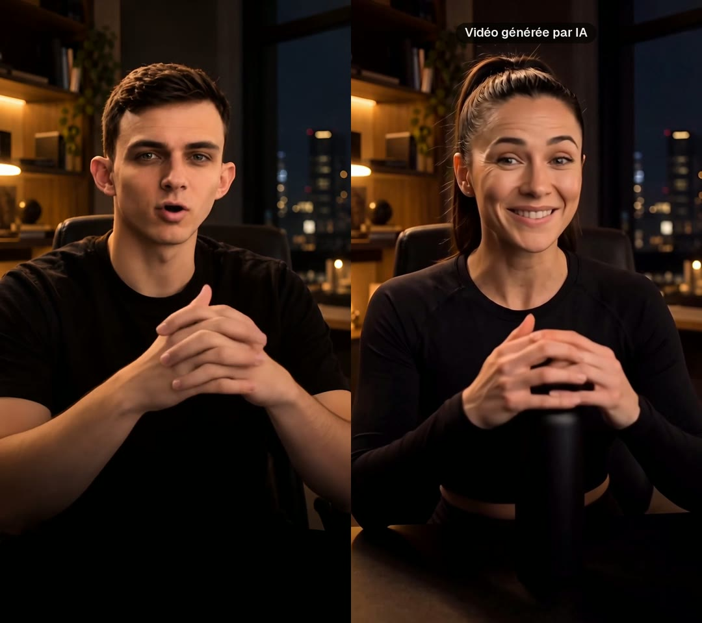

# /transfo : tu deviens quelqu'un d'autre en pleine phrase



Tu parles face caméra. À ta première pause, flash blanc, et une autre personne termine ta phrase **avec tes gestes, ton visage, ta bouche et ta voix transformée**, puis présente ton objet. C'est le format « transformation IA » qui fait des millions de vues, en une commande dans Claude Code.

    /transfo ma-video.mp4 en coach sportive qui présente ma gourde

Claude te donne d'abord le coût exact, attend ton accord, puis enchaîne :

1. **Nano Banana Pro** crée la nouvelle personne à partir d'une image de ta vidéo (même pose, même pièce, même objet) ;
2. **Kling 2.6 Motion Control** lui fait rejouer tes gestes et ta bouche ;
3. **ElevenLabs** transforme ta voix en gardant tes mots et ton rythme : tu parles français, elle parle français ;
4. montage : toi jusqu'à la bascule, flash, elle ensuite, mention « Vidéo générée par IA ».

## Installer

1. Copie le dossier `transfo` dans `~/.claude/skills/` (Mac / Linux) ou `%USERPROFILE%\.claude\skills\` (Windows) :

```bash
git clone --depth 1 https://github.com/achillebrl/skills-ia /tmp/skills-ia && cp -R /tmp/skills-ia/transfo ~/.claude/skills/
```

2. Installe [uv](https://docs.astral.sh/uv/) si tu ne l'as pas, puis relance Claude Code.
3. Crée une clé sur [fal.ai](https://fal.ai/dashboard/keys), ajoute quelques dollars et donne-la à Claude (`export FAL_KEY=…`).

## Ce que ça coûte

Environ **0,90 $ pour 12 s** de vidéo (prix publics fal.ai : 0,15 $ l'image, 0,07 $ par seconde transformée, 0,30 $ la minute de voix). Seules les secondes après la bascule sont transformées. Chaque étape payée est gardée : relancer ne repaie pas ce qui est déjà fait.

## Filmer

- Téléphone fixe, de la taille à la tête, mains visibles, gestes calmes.
- Une petite pause juste avant la phrase de l'autre personne : c'est là que ça bascule.
- L'objet à présenter bien visible, sans logo de marque.

Six personnes types et leurs voix sont dans [references/prompts.md](references/prompts.md).

## Les règles

- **Uniquement des personnes fictives**, ou toi-même transformé. Jamais le visage d'une vraie personne : c'est interdit par Instagram, TikTok et YouTube, et puni par la loi.
- Active l'étiquette **« Info IA »** (Instagram) ou **« Contenu généré par l'IA »** (TikTok) : c'est obligatoire, et imposé en Europe par l'AI Act depuis le 2 août 2026.
- Promo contre une contrepartie : **« Collaboration commerciale »**, et en France **« Images virtuelles »** pour un visage généré par IA.

— [@achille.ia](https://www.instagram.com/achille.ia/)
